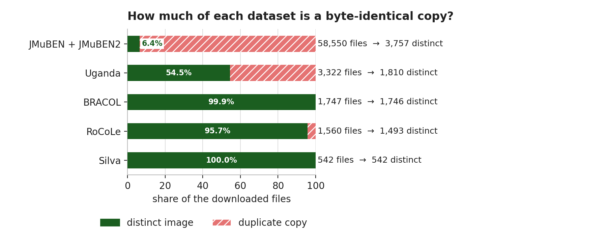
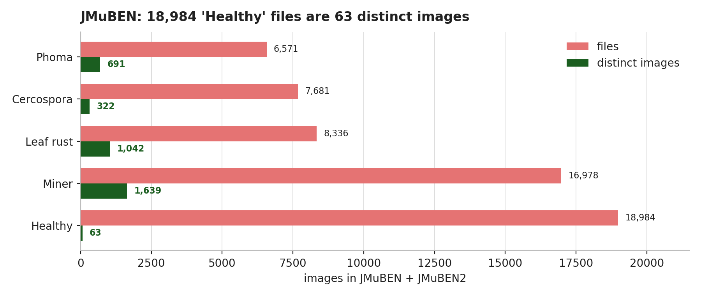

# Dataset cheat sheet — one page, read this first

> **The whole thing in one sentence:** we downloaded **65,721 files**, but only **9,348 are
> different images**. 85.8 % of the corpus is a byte-identical copy of something already in it.

Every number in this project passes through three stages. Most papers stop at the first.

| Stage | What it is | Example |
|---|---|---|
| **Claimed** | what the paper or dataset page says | "58,555 images" |
| **Files** | what the archive actually contains | 58,550 files |
| **Distinct** | what the model actually sees | **3,757 images** |

---

## 1. The picture



*Figure D.1 — share of each downloaded dataset that is a duplicate copy.*

If the image does not render (chat, print), the same thing in text:

```text
JMuBEN + JMuBEN2  ███████████████████████████████████████ 93.6 % copies
Uganda            ██████████████████ 45.5 %
RoCoLe            █▊ 4.3 %
BRACOL            ▏0.1 %
Silva             0 %
```

## 2. The table that ends the argument

| Dataset | Files | **Real images** | Copies | One-line verdict |
|---|---:|---:|---:|---|
| JMuBEN + JMuBEN2 | 58,550 | **3,757** | 93.6 % | 15× smaller than it looks |
| Uganda | 3,322 | **1,810** | 45.5 % | 102 files are zero bytes |
| BRACOL | 1,747 | **1,746** | 0.1 % | clean — after we repaired it |
| RoCoLe | 1,560 | **1,493** | 4.3 % | duplicates cross plants |
| Silva | 542 | **542** | 0 % | the only spotless archive |
| **Downloaded total** | **65,721** | **9,348** | **85.8 %** | **the corpus is 9,348, not 65,721** |

> **Why this matters:** a random split of 58,550 files puts the same photograph in train and test
> up to 300 times. That is how a model reports 99 % and then fails on a real farm.

## 3. The trap inside JMuBEN: "Healthy" is one leaf



*Figure D.2 — every class shrinks, but Healthy collapses.*

```text
Healthy      63  ▏
Cercospora  322  ██
Phoma       691  ████
Leaf rust 1,042  ██████
Miner     1,639  ██████████
```

18,984 "Healthy" files → **63 distinct images** (62 decodable), and visually they are frames of **one leaf** under
different white balance. A model trained on this learns "this leaf = healthy", not "healthy leaf".

**Consequence:** healthy training data must come from BRACOL (272) + Uganda (739) + RoCoLe (759).

## 4. What each dataset can actually test

✅ can test · ⚠️ weak / with a caveat · ❌ cannot test

| Dataset | Rust | Cercospora | Miner | Phoma | Healthy | African | Licence | Use |
|---|:-:|:-:|:-:|:-:|:-:|:-:|---|---|
| JMuBEN + JMuBEN2 | ✅ | ✅ | ✅ | ✅ | ⚠️ 63 | ✅ | CC BY 4.0 | train |
| BRACOL | ✅ | ✅ | ✅ | ✅ | ✅ | ❌ | CC BY 4.0 | train |
| RoCoLe | ✅ | ❌ | ❌ | ❌ | ✅ | ❌ | CC BY 4.0 | external |
| Silva | ✅ | ❌ | ✅ | ❌ | ❌ | ❌ | CC BY 4.0 | external |
| Uganda | ✅ | ❌ | ❌ | ✅ | ✅ | ✅ | CC BY 4.0 | external |
| Ethiopian | ✅ | ✅ | ❌ | ✅ | ✅ | ✅ | CC0 (claim) | test only |
| Uganda augmented | ✅ | ❌ | ❌ | ✅ | ✅ | ✅ | **CC BY-NC-SA** | ablation only |
| Saposoa | ✅ | ❌ | ❌ | ❌ | ✅ | ❌ | CC BY 4.0 | external |
| CoffeeLeaf-CO v2 | ✅ | ❌ | ✅ | ❌ | ❌ | ❌ | CC BY 4.0 | external |
| CerradoCoffeeLeaf | — | — | — | — | — | ❌ | unknown | cite only |

**Red spider mite is not leaf miner.** RoCoLe's mite class must be `unsupported`, never mapped to
Miner — that is a silent label error waiting to happen.

## 5. Licence traffic light

| | Licence | Datasets | Can we ship a model trained on it? |
|---|---|---|---|
| 🟢 | **CC BY 4.0** | JMuBEN, JMuBEN2, BRACOL, RoCoLe, Silva, Uganda | **Yes**, with attribution |
| 🟡 | **CC0** (uploader's claim) | Ethiopian | Probably — research use until provenance is confirmed |
| 🔴 | **CC BY-NC-SA 4.0** | Uganda augmented (Kaggle) | **No — non-commercial.** Ablation only |

## 6. Five findings, five lines

| # | Finding | The number |
|---|---|---|
| 1 | The primary benchmark is mostly copies | 58,550 files → **3,757** images |
| 2 | "Healthy" is one leaf photographed many times | 18,984 files → **63** (62 usable) |
| 3 | BRACOL's official archive is **truncated at the publisher** | **1,402 / 1,747**; detected by SHA-256, repaired |
| 4 | Uganda's "duplicates removed" claim is false | **45.5 %** duplicates + **102** zero-byte files |
| 5 | RoCoLe's duplicates cross plants — and disagree on labels | **67** duplicates, **27** with contradictory labels |

## 7. Why a 99 % model still fails in the field

| What is measured | Number | What it tells you |
|---|---:|---|
| In-dataset accuracy, published models | 99 %+ | the benchmark looks solved |
| External field rust recall, one public model | **1.9 %** (16/847) | it is not solved |
| Our corpus, counted honestly | **9,348**, not 107,871 | the test must be external |

The gap is not a modelling failure. It is a **data** failure: train and test came from the same
copies, so the model never had to generalise.

## 8. If you remember only three things

1. **Files ≠ images.** Always ask for the distinct count, not the folder size.
2. **Healthy is the bottleneck**, not rust. 62 usable healthy images cannot teach a class.
3. **Deduplicate before splitting.** Otherwise the test set is a copy of the training set.

## 9. Read next

| If you want… | Open |
|---|---|
| all 11 datasets in one table | `docs/15-MASTER-DATASET-REPORT.md` |
| the method, the proof, the limitations | `docs/14-DUPLICATION-AUDIT.md` |
| evidence tiers (T1–T4) and what was rejected | `docs/12-DATASET-VERIFICATION.md` |
| URLs, DOIs, licences, repair notes | `data/dataset-sources.md` |
| the machine-readable counts | `data/audit/duplication-report.json` |

---

*All counts measured 8 November 2026. Reproduce with
`python scripts/audit_duplicates.py --raw data/raw --out data/audit`; regenerate the figures with
`python scripts/make_dataset_figures.py`.*
