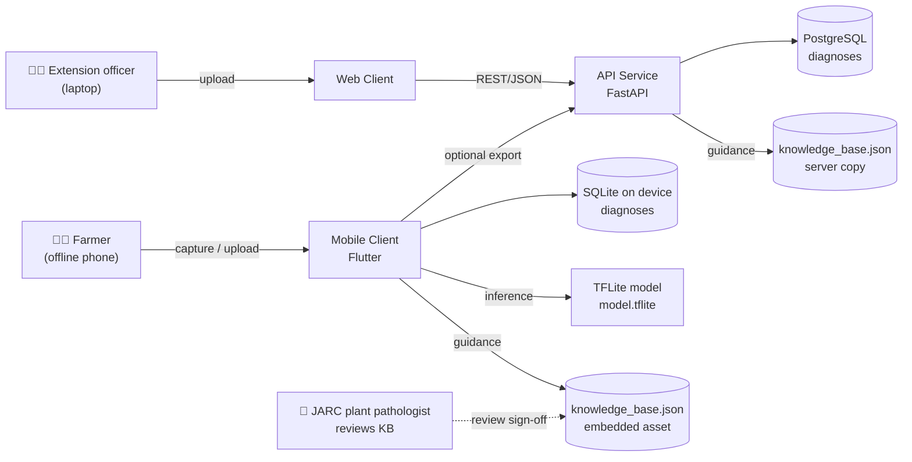
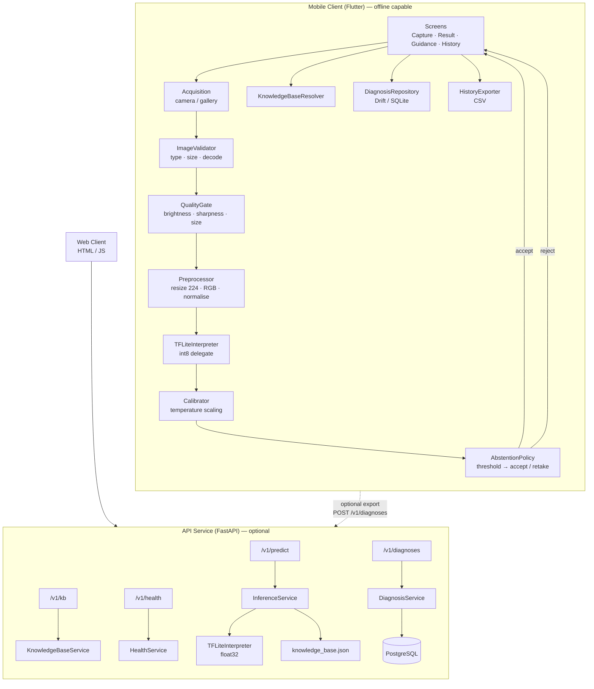
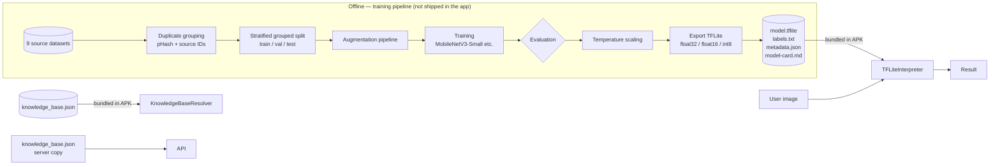
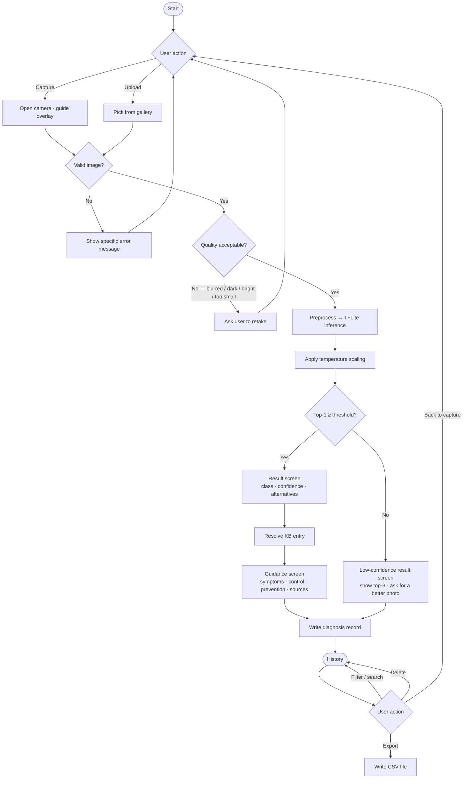
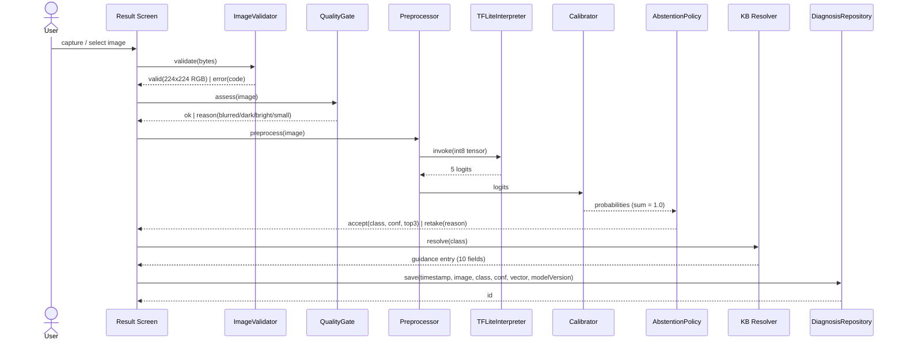
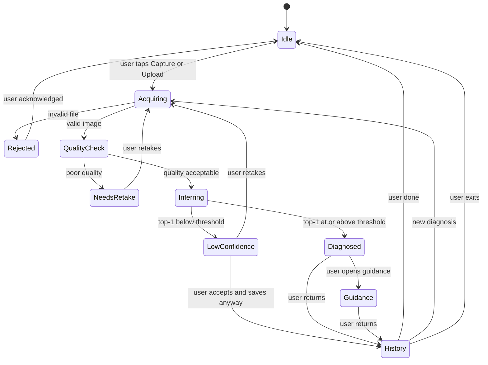
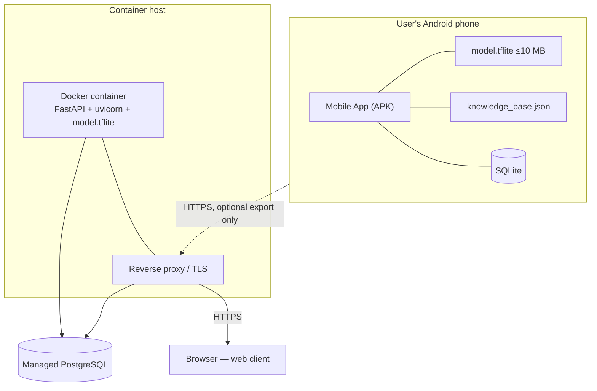
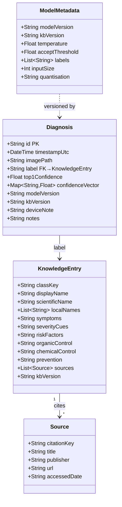

# System Architecture and Design

**Project:** Design and Development of a Coffee Leaf Disease Diagnosis System Using Deep Learning
**Version:** 1.0
**Owner:** Yohannes Berhanu (architecture) · **Contributors:** Bemnet Tesfaye (app layers), Hayredin Mohammed (model pipeline), Nahom Solomon (KB layer)

> **Guideline §7.4** recommends a use-case diagram, activity diagram, sequence diagram, class
> diagram, state diagram, relational schema, data dictionary, architecture, component/deployment
> diagram, data-flow diagram, wireframes, algorithm pseudocode and a prototype. §7.5 requires
> that these represent the **actual** system and never contradict the requirements.
>
> **Diagrams in this file are written in Mermaid.** Render them to PNG before submitting the
> report (Guideline §11.7: *"Figures must be legible when printed"*). Use `mmdc` or a
> Mermaid Live Editor export. Every figure caption credits its source if it is not original.

---

## 1. Design principles

| # | Principle | Consequence |
|---|---|---|
| P1 | **The offline core is the product.** Everything a farmer needs must work with the radio off | The model, the knowledge base and the history are all on-device. The server is optional |
| P2 | **One model, two front-ends.** Never two models | A single TFLite artefact and a single KB JSON are shared by the app and the API. This guarantees the app and the web client cannot disagree |
| P3 | **The model is a data product, not a binary** | The artefact ships as `model.tflite` + `labels.txt` + `metadata.json` + `model-card.md`, and the app reads the threshold and the label map from the metadata rather than hard-coding them |
| P4 | **Abstain rather than guess** | Confidence calibration and an acceptance threshold are part of the inference contract, not an optional extra |
| P5 | **Offline data is first-class** | The local SQLite store is the source of truth for history on the device; the server is a synchronisation target, not an authority, in v1 |
| P6 | **Version everything** | The model version, the KB version and the schema version travel with every diagnosis record |
| P7 | **Testability is a design constraint** | Every module boundary is a seam that has a unit test |

## 2. Technology decision record

| Layer | Choice | Alternatives considered | Why this one | Owner |
|---|---|---|---|---|
| Mobile framework | **Flutter 3.x (Dart)** | React Native, native Kotlin | One codebase for Android + iOS; the best-supported TFLite plugin (`tflite_flutter`); camera, gallery and SQLite plugins are mature; one language for the whole client | Bemnet |
| On-device runtime | **TFLite (LiteRT) via `tflite_flutter`** | ONNX Runtime Mobile, TF Lite Micro | Model Maker produces the `.tflite` with metadata directly; the MediaPipe Image Classifier task provides a validated image-classification pipeline with a score threshold and a label allow-list [48]; TF Lite Micro targets microcontrollers, not phones | Hayredin |
| Model architecture | **MobileNetV3-Small**, compared against **EfficientNet-Lite0** and **MobileNetV2** | ConvNeXt-S, EfficientNet-B2 | Both are TFLite-supported and phone-targeted [36], [40]. ConvNeXt-S is 99 MB and misses Cercospora badly [33]; EfficientNet-B2 is 8.57 MB but has 1.9 % external rust recall [34]. We want a model we can actually trust, so we train and compare | Hayredin |
| Quantisation | **int8 post-training quantisation**, with float16 and float32 kept for comparison | Dynamic-range quantisation, full-integer with a representative dataset | Documented to shrink plant-disease models with no accuracy loss [41]; LiteRT supports float fallback for mixed precision [43] | Hayredin |
| Local database (mobile) | **SQLite via `sqflite`, wrapped in Drift** | Hive, Isar, Realm | SQL is queryable and auditable; Drift adds typed DAOs, schema versioning and migrations, which FR-20 requires | Bemnet |
| Local database (server) | **PostgreSQL 16** | SQLite, MySQL | Concurrent writes from multiple extension officers; `jsonb` for the confidence vector; standard | Yohannes |
| ORM and migrations | **SQLAlchemy 2.0 + Alembic** | Django ORM, raw SQL | Typed, migration-supported, framework-light | Yohannes |
| API framework | **FastAPI + Pydantic v2** | Flask, Django REST, Express | Automatic OpenAPI generation satisfies FR-28; Pydantic validation satisfies NFR-18 directly; async performance | Yohannes |
| Web client | **Vanilla HTML/CSS/JS** (no build step) | React, Vue, Svelte, Gradio | Zero build risk in the last week before the defense; the OpenAPI schema guarantees the contract; a Gradio app would not support the history browsing and export that FR-33 requires | Yohannes + Bemnet |
| Authentication | **JWT bearer tokens** | Sessions, API keys | Stateless, works for both front-ends, standard | Yohannes |
| Model registry | **A versioned directory + a `manifest.json`** | MLflow | No extra infrastructure to run for the defense; the manifest is human-readable evidence | Hayredin |
| Experiment tracking | **YAML configs + a `results.md` table** | W&B, TensorBoard | Reproducibility requirement §9.7 asks for a table linking each result to its script — that *is* the artefact | Hayredin |
| CI | **GitHub Actions** | Jenkins, GitLab CI | Free, zero setup, and the repository is already on GitHub for the advisor and examiners (§8.4) | Yohannes |
| Deployment | **Docker + a free-tier container host** | Kubernetes, VMs | Reproducible, cheap, demonstrable. The API is stateless behind a container | Yohannes |

**Rejected on purpose:** a microservices split (the API is one service — splitting it would add
deployment risk for no benefit); a message queue (no asynchronous work); a NoSQL store (the
history is relational and queryable); a federated learning approach (out of scope; the data
privacy argument does not bind because no personal data is collected).

---

## 3. System context (Figure 4.1)



**Figure 4.1** — System context diagram.

---

## 4. Component diagram (Figure 4.2)



**Figure 4.2** — Component diagram of the three deployable components.

**Component responsibilities**

| Component | Responsibility | Does **not** do |
|---|---|---|
| Acquisition | Obtain a frame or a file; nothing else | No validation, no inference |
| ImageValidator | Reject non-images, undersized and oversized files before any compute | No quality judgement |
| QualityGate | Compute brightness, sharpness and foreground-ratio proxies; return a reason code | No disease classification |
| Preprocessor | Deterministic resize → RGB → normalise → quantise to int8. Must be bit-identical to the training pipeline (golden-image test) | No augmentation at inference time |
| TFLiteInterpreter | Run the model; return the raw five-logit vector | No post-processing |
| Calibrator | Apply the stored temperature `T` to the logits and convert to probabilities | No thresholding |
| AbstentionPolicy | Compare the top-1 probability with the threshold; return `accept` or `retake(reason)` | No overriding of the class |
| KnowledgeBaseResolver | Look up the class in the embedded KB; return the 10-field entry | No network access |
| DiagnosisRepository | Persist and query diagnosis records | No business logic |
| HistoryExporter | Stream records to CSV | No deletion |
| InferenceService (server) | Same preprocessing and model, float32, with the same KB | No abstention on the server by default (the API returns the raw vector so the client can decide) |

---

## 5. Data-flow diagram (Figure 4.3)



**Figure 4.3** — Data flow: the training pipeline produces versioned artefacts that are bundled
into the app; the runtime path is entirely local.

**The two contracts that must not drift:**

1. **Preprocessing contract.** The training pipeline and the app must implement byte-identical
   preprocessing. This is enforced by a **golden-image test**: a fixed set of 20 images is
   preprocessed by the Python reference implementation and by the Dart implementation, and the
   resulting tensors are compared element-wise. A mismatch fails CI.
2. **Artefact contract.** `labels.txt` order must equal the training `class_index` order, must
   equal the KB key order, and must equal the API's enum order. A CI check asserts all four
   match.

---

## 6. Activity diagram — the core flow (Figure 4.4)



**Figure 4.4** — Activity diagram of the diagnosis flow.

---

## 7. Sequence diagram — inference (Figure 4.5)



**Figure 4.5** — Sequence diagram of the inference path.

**Pseudocode for the abstention decision (the single most important algorithm in the system):**

```
function classify(imageBytes):
    validated = ImageValidator.validate(imageBytes)
    if not validated.ok:
        return Failure(validated.code)              # e.g. NOT_AN_IMAGE, TOO_SMALL, TOO_LARGE

    quality = QualityGate.assess(validated.image)
    if not quality.ok:
        return Retake(quality.reason)                # e.g. TOO_DARK, BLURRED, LEAF_TOO_SMALL

    tensor = Preprocessor.toTensor(validated.image)  # 1x224x224x3 int8
    logits = TFLiteInterpreter.invoke(tensor)       # 5 values

    probs = Calibrator.apply(logits, T)             # softmax(logits / T), T from metadata.json
    ranked = sortDescending(probs)
    top1   = ranked[0]

    if top1.probability < metadata.acceptThreshold:
        return Retake(LOW_CONFIDENCE, ranked)        # user is asked for a better photo
                                                # NOTE: the class is NOT displayed as a diagnosis

    guidance = KnowledgeBaseResolver.resolve(top1.label)
    DiagnosisRepository.save(
        timestamp    = nowUtc(),
        imageRef     = store(imageBytes),
        label        = top1.label,
        confidence   = top1.probability,
        vector       = probs,
        modelVersion = metadata.modelVersion,
        kbVersion    = metadata.kbVersion)
    return Accept(top1, ranked, guidance)
```

---

## 8. State diagram — the diagnosis lifecycle (Figure 4.6)



**Figure 4.6** — State diagram of the diagnosis lifecycle.

**Invariant:** `Diagnosed` is reachable only from `Inferring` and only when the top-1
probability is at or above the threshold stored in `metadata.json`. The `LowConfidence` state
**never** renders a diagnosis as a diagnosis.

---

## 9. Deployment diagram (Figure 4.7)



**Figure 4.7** — Deployment diagram.

**Offline guarantee.** The mobile app has **no** startup dependency on the server. The API is
contacted only for optional export and for the optional web features. A network failure can
never block the core flow.

---

## 10. Class diagram — the domain model (Figure 4.8)



**Figure 4.8** — Class diagram of the domain model.

---

## 11. Error handling and validation policy

| Condition | Layer | Response | User-facing message |
|---|---|---|---|
| Not a decodable image | ImageValidator | Reject before decode | "This file is not an image. Please choose a photo of a leaf." |
| < 64×64 | ImageValidator | Reject | "The image is too small. Please take a higher-resolution photo." |
| > 20 MB | ImageValidator | Reject before reading fully | "The image is too large. Please use a smaller photo." |
| Blurred | QualityGate | Soft-reject with a reason | "The photo looks blurry. Please steady the phone and retake." |
| Too dark / too bright | QualityGate | Soft-reject | "The photo is too dark / too bright. Please retake in better light." |
| Leaf too small in frame | QualityGate | Soft-reject | "Please fill the frame with a single leaf." |
| Top-1 below threshold | AbstentionPolicy | Soft-reject with the top-3 shown, the class **not** labelled as a diagnosis | "We are not confident enough to give a diagnosis. Please retake the photo in better conditions." |
| TFLite interpreter failure | InferenceService | Catch, log, show a recoverable error | "Something went wrong while analysing the photo. Please try again." |
| Local DB write failure | DiagnosisRepository | Retry once, then surface a non-blocking warning; **never lose the screen state** | "The diagnosis could not be saved to the history. You can retry from the history screen." |
| Network unavailable | API client | Time out after 5 s, disable the network-dependent feature, keep the core flow alive | "You are offline. The diagnosis still works; syncing is unavailable." |
| API 4xx / 5xx | API client | Map to a clear message; log the correlation id | "The server could not complete the request. Please try again shortly." |

**Policy.** Every failure path must be reachable by a test. A code path with no test is a
defect (Guideline §10.1).

---

## 12. Security design (Guideline §8.3, OWASP Top 10)

| Threat | Control |
|---|---|
| **A01 Broken access control** | JWT bearer tokens on all mutating endpoints; the server's history endpoints are scoped to a token subject; the device-local history is sandboxed by the OS |
| **A02 Cryptographic failures** | TLS everywhere for the API; bcrypt/argon2 for any password; no credentials in the repo |
| **A03 Injection** | SQLAlchemy parameterised queries only; no string-built SQL anywhere; Pydantic validation on every input |
| **A04 Insecure design** | The acceptance threshold and the refusal-to-diagnose path are designed behaviours, not error handling; the advisory notice is a designed element |
| **A05 Security misconfiguration** | No debug mode in production; no directory listing; CORS restricted to the declared web origin; the container runs as a non-root user |
| **A06 Vulnerable and outdated components** | `pip-audit` and `flutter pub outdated` in CI; the SBOM is exported with the release |
| **A07 Identification and authentication failures** | Short-lived tokens, rate limiting, no default credentials |
| **A08 Software and data integrity failures** | Images are validated by magic bytes, not by extension or client-supplied MIME type; the model artefact carries a SHA-256 checksum verified at load time |
| **A09 Logging and monitoring failures** | Structured logs with a request correlation id; no personal data or image content logged |
| **A10 SSRF** | No outbound URL fetching; the API never fetches a URL supplied by a client — this is a deliberate design decision, since the "predict by URL" pattern of some prior art [28] is an SSRF vector |

**Data privacy.** The system stores only: a leaf photograph, a timestamp, a predicted class, a
confidence vector, a model version, and an optional free-text note. There are no accounts, no
names, no locations, no device identifiers beyond an optional free-text note the user types
themselves. Nothing leaves the device unless the user explicitly exports.

---

## 13. Design-to-requirement consistency checklist

Run this before the design review and again before submission.

- [ ] Every FR/NFR in `requirements-spec.md` maps to a component in Figure 4.2. (Traceability
      matrix §4.)
- [ ] Every endpoint in `api-spec.md` exists in the OpenAPI schema and is tested (FR-21…FR-30).
- [ ] The seven fields in FR-14 exist as columns in both the on-device and the server schema.
- [ ] The five label strings are identical across `labels.txt`, the KB, the API enum and the UI.
- [ ] The acceptance threshold is read from `metadata.json`, not hard-coded, and the value in
      `model-card.md` matches.
- [ ] The preprocessing golden-image test passes.
- [ ] Every error condition in §11 has at least one test case in Appendix F.
- [ ] The diagrams match the code. Any divergence is fixed in the diagram or the code — never
      both (Guideline §7.5).
