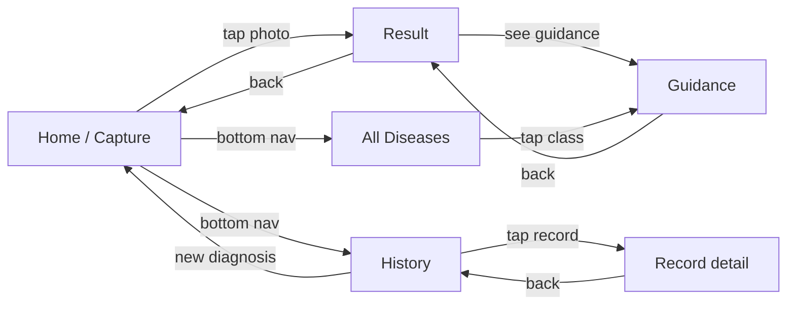

# UI Wireframes and Screen Design

**Owner:** Bemnet Tesfaye · **Reviewer:** Nahom Solomon (usability), Yohannes Berhanu (API contract)
**Tool:** Figma (free tier) → exported to PNG for the report; the ASCII sketches below are the
working reference for implementation.

> **Guideline §11.7:** *"Figures must be legible when printed. Draw diagrams yourself or credit
> the source at the end of the caption."* The wireframes below are original work by the group.

---

## Design language

| Token | Value | Note |
|---|---|---|
| Primary | Deep green `#1B5E20` | Coffee-leaf association; ≥ 4.5:1 contrast on white |
| Secondary | Earth brown `#6D4C41` | Used for the disease category accents |
| Alert / abstain | Amber `#F9A825` | Never red for a low-confidence state — red implies an error, but the model simply is not sure |
| Success | `#2E7D32` | Accepted diagnosis |
| Surface | `#FAFAFA` | Background |
| Corner radius | 16 dp | Cards |
| Minimum touch target | 48×48 dp | NFR-14 |
| Minimum body text | 16 sp | Readable in bright sunlight with an older user |
| Icon set | Material Symbols | Free, consistent |

**Accessibility rules.** Minimum 4.5:1 contrast for body text; the class name is never
communicated by colour alone — every class has an icon and a text label; the layout reflows at
font scale 2.0; every icon button has a semantic label.

**Localisation.** All strings live in `l10n/app_en.arb` and `l10n/app_am.arb` (NFR-15). Amharic
strings are placeholders until a qualified translator reviews them — the report states this
honestly rather than shipping unreviewed Amharic text.

---

## Screen 1 — Home / Capture (Figure 4.10)

```
┌──────────────────────────────────────┐
│  ☰   Coffee Leaf Doctor        🌐 EN  │  ← menu · title · locale
├──────────────────────────────────────┤
│                                      │
│   ┌────────────────────────────┐     │
│   │                            │     │
│   │      ( live camera view )   │     │
│   │                            │     │
│   │      ╭────────────╮        │     │  ← framing guide: a dashed leaf outline
│   │      │            │        │     │     with "Fill the frame with ONE leaf"
│   │      ╰────────────╯        │     │
│   │                            │     │
│   └────────────────────────────┘     │
│                                      │
│   ⚠ Blurred · too dark · glare ·     │  ← live quality hints, greyed when OK
│     small leaf                       │
│                                      │
├──────────────────────────────────────┤
│                                      │
│      ┌──────────────────────────┐    │
│      │      📷  TAKE PHOTO      │    │  ← primary, 56 dp tall
│      └──────────────────────────┘    │
│                                      │
│      ┌──────────────────────────┐    │
│      │   🖼  CHOOSE FROM GALLERY │    │
│      └──────────────────────────┘    │
│                                      │
├──────────────────────────────────────┤
│  🕘  History      📖  All Diseases   │  ← bottom navigation
└──────────────────────────────────────┘
```

**States.** Idle · camera permission not yet granted (an explanatory card with a "Grant
access" button, never a silent failure) · camera unavailable (a message explaining that a
camera is needed for capture while the gallery route still works) · device not supported
(NFR-16).

**FR mapping:** FR-01, FR-02, FR-03, FR-05.

---

## Screen 2 — Result (Figure 4.11)

```
┌──────────────────────────────────────┐
│  ←  Diagnosis                    ⋮   │
├──────────────────────────────────────┤
│  ┌────────────────────────────────┐  │
│  │  [ photo thumbnail ]           │  │
│  │                                │  │
│  │  ● Coffee Leaf Rust            │  │  ← icon + name (never colour alone)
│  │  Hemileia vastatrix            │  │
│  │                                │  │
│  │  Confidence      87%           │  │  ← a horizontal bar, plus the number
│  │  ███████████████░░░░░          │  │
│  │  ▲ High confidence              │  │
│  └────────────────────────────────┘  │
│                                      │
│  Other possibilities                 │
│  Cercospora Leaf Spot          6%    │  ← FR-10: ranked alternatives
│  Leaf Miner                    4%    │
│  Phoma Leaf Spot               2%    │
│  Healthy                       1%    │
│                                      │
│  ┌────────────────────────────────┐  │
│  │  ℹ  This is decision support.  │  │  ← FR-12 advisory notice
│  │  For a firm diagnosis and      │  │
│  │  treatment, contact your       │  │
│  │  extension officer.            │  │
│  └────────────────────────────────┘  │
│                                      │
├──────────────────────────────────────┤
│   ┌──────────────────────────────┐   │
│   │   📖  SEE TREATMENT GUIDANCE  │   │  ← FR-11, one tap from the result
│   └──────────────────────────────┘   │
│   ┌──────────────────────────────┐   │
│   │   💾  SAVE TO HISTORY         │   │  ← auto-saved, but explicit is clearer
│   └──────────────────────────────┘   │
└──────────────────────────────────────┘
```

**Low-confidence variant** (FR-09). The class name is **replaced**, not shown in grey:

```
│  ┌────────────────────────────────┐  │
│  │  ⚠  Not confident enough       │  │
│  │                                │  │
│  │  We could not identify this    │  │
│  │  leaf with enough certainty.   │  │
│  │                                │  │
│  │  Best guesses:                 │  │
│  │  Cercospora Leaf Spot   38%    │  │
│  │  Leaf Miner             31%    │  │
│  │                                │  │
│  │  📷  Retake the photo          │  │
│  │  Suggestions: brighter light,  │  │
│  │  fill the frame with the leaf, │  │
│  │  avoid blur                    │  │
│  └────────────────────────────────┘  │
```

**Rationale.** Showing the class name with a low confidence invites the user to act on a guess.
Showing the *ranking* without a label is informative and non-misleading. This follows the
prior art, where both published model cards advise asking for a better photo below a
confidence threshold.

**FR mapping:** FR-06, FR-07, FR-09, FR-10, FR-12.

---

## Screen 3 — Guidance (Figure 4.12)

```
┌──────────────────────────────────────┐
│  ←  Coffee Leaf Rust                │
├──────────────────────────────────────┤
│  Hemileia vastatrix · የቡና ርስት      │
│                                      │
│  ── SYMPTOMS ─────────────────────   │
│  Pale yellow spots on the underside  │
│  of the leaf, turning powdery and    │
│  orange-yellow ...                   │
│                                      │
│  ── HOW TO SPOT SEVERITY ─────────   │
│  Very low <5% of leaf area ·        │
│  Low 5–10% · High 10–15% ·          │
│  Very high >15%                     │
│                                      │
│  ── ORGANIC CONTROL ─────────────   │
│  • Remove and destroy infected       │
│    leaves and fallen debris ...      │
│                                      │
│  ── CHEMICAL CONTROL ─────────────   │
│  • Contact fungicides registered    │
│    for coffee leaf rust, following   │
│  ...                                │
│                                      │
│  ── PREVENTION ──────────────────   │
│  • Shade and ventilation, balanced  │
│    nutrition, resistant varieties    │
│                                      │
│  ── SOURCES ─────────────────────   │
│  [1] Berihun & Alemu 2022           │
│  [2] FAO, Coffee manual, ch. 9       │
│  [3] Yirga 2020                     │
│                                      │
├──────────────────────────────────────┤
│   Save to history                    │
└──────────────────────────────────────┘
```

**Rules.** The KB entry always ends with its sources, so the guidance is auditable in the
field. Treatment text is written at a reading level a farmer can act on, with the technical
name in parentheses. **No chemical product is recommended by name** — the app names the
*active ingredient class* and directs the user to a locally registered product and a label, so
the app cannot be the source of an incorrect or illegal dosage recommendation.

**FR mapping:** FR-11, FR-13, FR-35, FR-36.

---

## Screen 4 — History (Figure 4.13)

```
┌──────────────────────────────────────┐
│  ←  Diagnosis History         ⤓ CSV │
├──────────────────────────────────────┤
│  🔍  Search...                       │
│  ┌─────────┐ ┌─────────┐ ┌────────┐ │
│  │ All     │ │ Rust    │ │Healthy │ │  ← horizontal filter chips
│  └─────────┘ └─────────┘ └────────┘ │
│  📅  Date range ▾                    │
├──────────────────────────────────────┤
│  ┌────────────────────────────────┐  │
│  │ [img] Coffee Leaf Rust    87%  │  │
│  │       14 Mar 2027 · 08:22     │  │
│  │                       🗑  ⓘ   │  │
│  ├────────────────────────────────┤  │
│  │ [img] Healthy            94%  │  │
│  │       13 Mar 2027 · 16:05     │  │
│  │                       🗑  ⓘ   │  │
│  ├────────────────────────────────┤  │
│  │ [img] Leaf Miner         72%  │  │
│  │       11 Mar 2027 · 10:47     │  │
│  │                       🗑  ⓘ   │  │
│  └────────────────────────────────┘  │
│                                      │
├──────────────────────────────────────┤
│  🕘  History      📖  All Diseases   │
└──────────────────────────────────────┘
```

**Empty state.** "No diagnoses yet. Take a photo of a leaf to begin." with a button.
**Delete.** A confirmation dialog naming the record. **Export.** Writes a CSV to the shared
folder and shows the path.

**FR mapping:** FR-14…FR-20.

---

## Screen 5 — All Diseases (knowledge base browser) (Figure 4.14)

```
┌──────────────────────────────────────┐
│  ←  All Coffee Leaf Diseases         │
├──────────────────────────────────────┤
│  ┌────────────────────────────────┐  │
│  │ 🟤 Coffee Leaf Rust             │  │
│  │    Hemileia vastatrix           │  │
│  └────────────────────────────────┘  │
│  ┌────────────────────────────────┐  │
│  │ 🟠 Cercospora Leaf Spot         │  │
│  │    Cercospora coffeicola        │  │
│  └────────────────────────────────┘  │
│  ┌────────────────────────────────┐  │
│  │ 🟢 Leaf Miner                   │  │
│  │    Leucoptera coffeella         │  │
│  └────────────────────────────────┘  │
│  ┌────────────────────────────────┐  │
│  │ 🔵 Phoma Leaf Spot              │  │
│  │    Phoma costarricensis         │  │
│  └────────────────────────────────┘  │
│  ┌────────────────────────────────┐  │
│  │ ⚪ Healthy                      │  │
│  └────────────────────────────────┘  │
└──────────────────────────────────────┘
```

**FR mapping:** FR-13.

---

## Navigation model



**Navigation principles.** No hidden gestures. Every screen has a visible back affordance.
The bottom navigation has two tabs (History, All Diseases); the capture action is the
primary button on Home, because it is the only thing a first-time user needs. The result
screen is reached from Home and returns to Home, so the flow is always one tap from
starting a new diagnosis.

---

## Web client screens

The web client reuses the API and mirrors Screens 2, 3 and 4, with two additions:

1. **A sign-in panel** — the API requires a token for the history routes.
2. **A dataset-note panel** — a static panel listing the model version and the macro-F1 on
   each external dataset, so a visitor can see the honest performance profile rather than
   only the demo. This is the web client's most valuable feature for the defense.

---

## Accessibility and usability checklist (before the usability study)

- [ ] Every interactive element is ≥ 48×48 dp
- [ ] `flutter analyze` reports no accessibility lint issues
- [ ] Text scales correctly at font scale 2.0 with no clipped text
- [ ] Every icon-only control has a semantic label
- [ ] The class identity is never conveyed by colour alone
- [ ] The advisory notice is visible without scrolling
- [ ] All strings are in the localisation files
- [ ] The low-confidence state has been shown to a real user and understood (usability study)
- [ ] The app is usable one-handed (the capture button is in the lower third)
